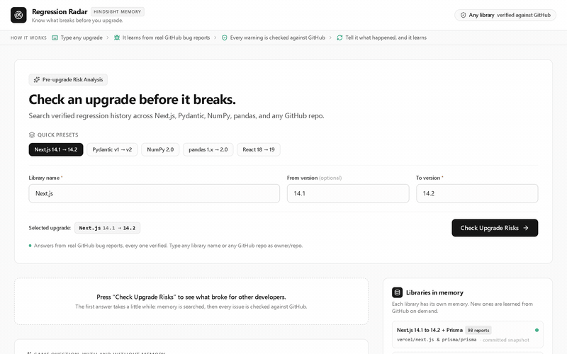
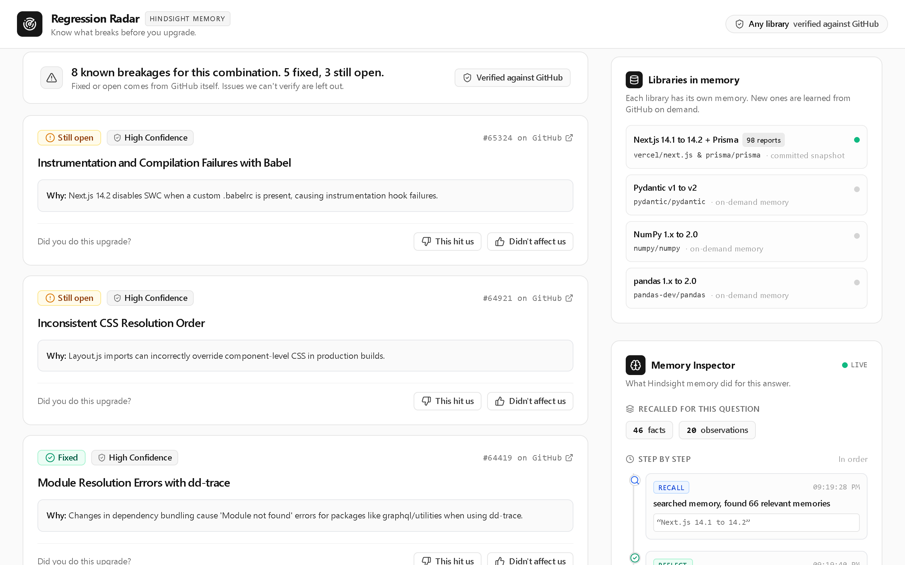
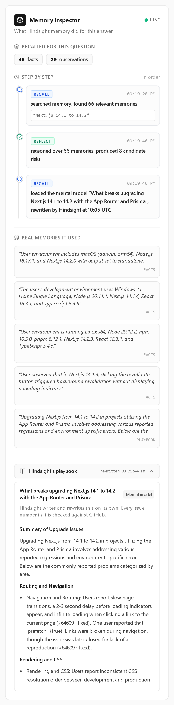
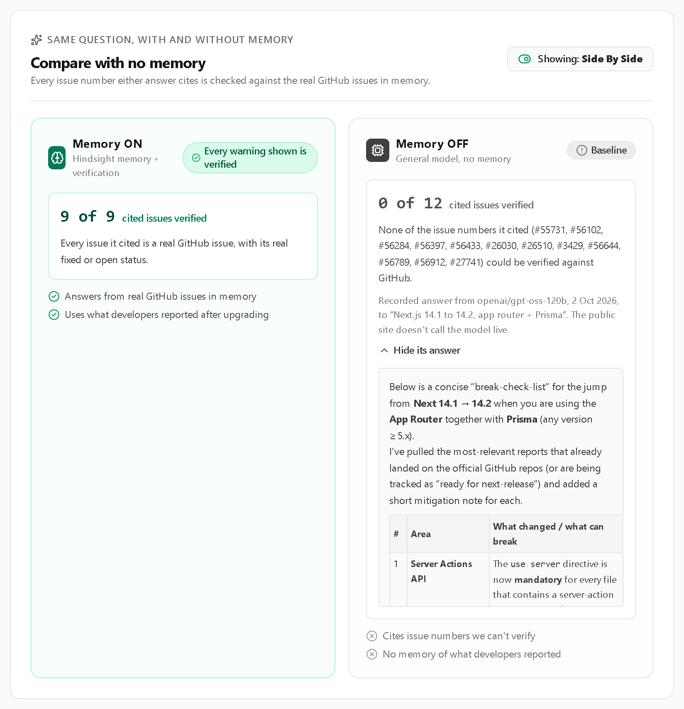
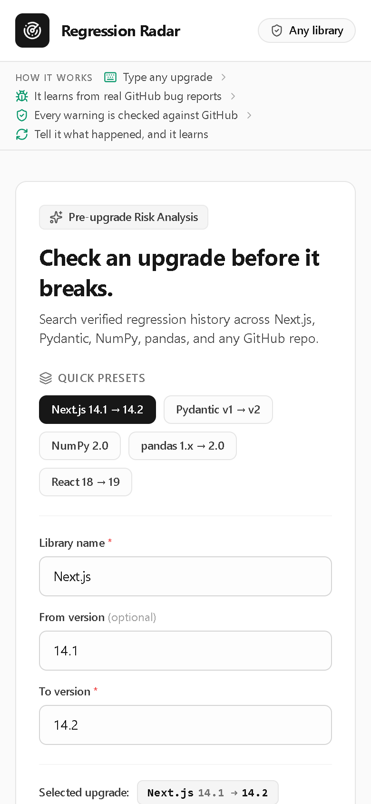
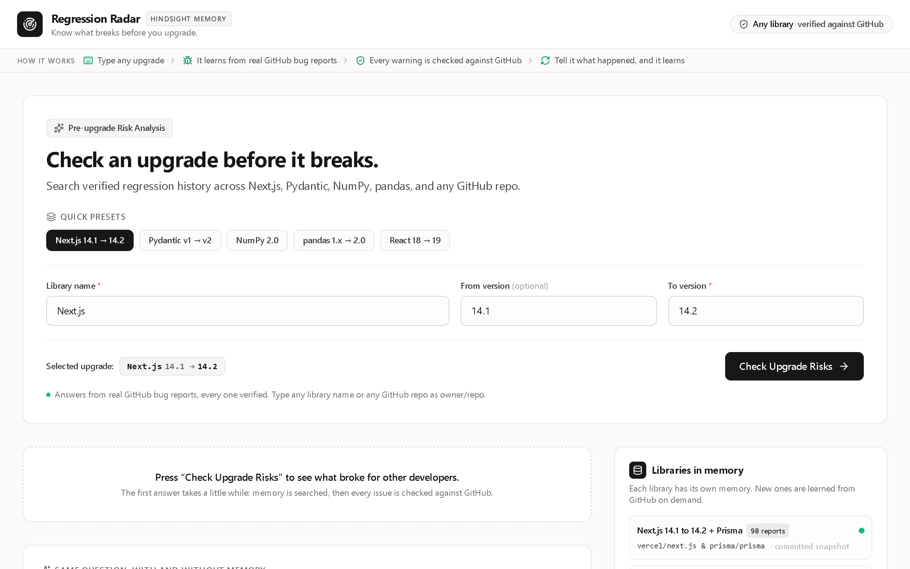
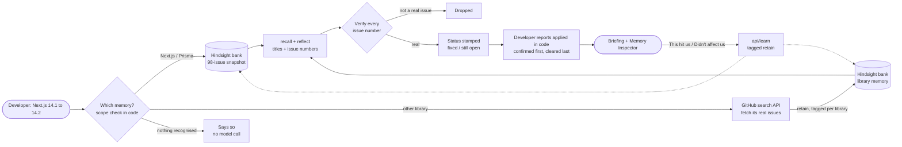

<p align="center">
  <a href="https://regression-radar.vercel.app">
    
  </a>
</p>

<p align="center">
  <a href="https://regression-radar.vercel.app"></a>
  <a href="https://github.com/ekupekuAI/regression-radar/deployments"></a>
  <a href="https://github.com/vectorize-io/hindsight"></a>
  
</p>

<p align="center">
  
</p>

<p align="center">
  <a href="https://regression-radar.vercel.app"><b>Try it live</b></a>
  &nbsp;·&nbsp;
  <a href="#-see-it-work">See it work</a>
  &nbsp;·&nbsp;
  <a href="#-how-it-works">How it works</a>
  &nbsp;·&nbsp;
  <a href="#-quickstart">Quickstart</a>
  &nbsp;·&nbsp;
  <a href="#-whats-new-in-this-version">What's new</a>
</p>

---

## 🛰️ What it is

**Regression Radar tells you what is likely to break in a library upgrade, using real bug reports other developers already filed. It never shows an issue number it can't verify.**

We asked a capable general model, with no memory, what breaks when you take a Next.js 14.1 app with Prisma to 14.2. It answered with confidence and cited **12 GitHub issue numbers**. We looked every one up in our snapshot of 98 real bug reports from that upgrade. **None of them were there.**

Regression Radar answers the same question from a [Hindsight](https://github.com/vectorize-io/hindsight) memory of those real reports. The model only picks *which* reports are relevant; the code decides what is true. Every cited issue is checked against the real issue list before you see it, its fixed or open status is stamped from GitHub, and anything that can't be checked is left out. When you tell it what actually happened in your upgrade, the next developer gets a better answer.

<p align="center">
  
</p>

<sub>Left: the recorded no-memory answer from <code>openai/gpt-oss-120b</code>, 2 October 2026 (<a href="data/baseline-recorded.json"><code>data/baseline-recorded.json</code></a>). Right: what the live app returned for the same question. "Not in the snapshot" means we couldn't verify the number. It doesn't prove the issue doesn't exist, so we never say it was made up.</sub>

## 🎬 See it work

<p align="center">
  
</p>

<sub>Recorded against the live site: press <b>Check Upgrade Risks</b>, memory is searched, citations are verified, then the results, the Memory Inspector and the no-memory comparison.</sub>

## ✨ Features

| | Feature | What it does |
|:-:|---|---|
| 🔎 | **Any library** | Pick a preset (Next.js, Pydantic, NumPy, pandas, React), type a common name such as Flask, Vue, Rails or PyTorch, or give any GitHub repo as `owner/repo`. |
| 🧠 | **Answers from memory** | Hindsight `recall` + `reflect` over real bug reports, asked for the 5 to 8 most relevant breakages and the issue numbers behind each. |
| ✅ | **Verified citations** | Every issue number is checked against the real issue list. Unverifiable ones are dropped, and *fixed / still open* comes from GitHub, never from the model. |
| 📚 | **Learns new libraries on demand** | The first question about a new library fetches its real GitHub issues into its own tagged memory. The briefing comes about a minute later. |
| 👍 | **Learns from your upgrade** | Mark each warning **This hit us** or **Didn't affect us**, or write what happened. Confirmed warnings move to the top; cleared ones sink. |
| ⚖️ | **Memory on vs off** | The same question answered by a general model with no memory, with its citations checked the same way. |
| 🔬 | **Memory Inspector** | Shows each recall, reflect and retain step, which kinds of memory came back, real memories it used, and Hindsight's self-rewriting playbook. |
| 🚧 | **Says when it doesn't know** | A stack it can't place gets "I don't recognise a library…" instead of a confident answer about something else. |

## 📸 Screenshots

<table>
  <tr>
    <td width="62%"></td>
    <td width="38%"></td>
  </tr>
  <tr>
    <td><b>Results.</b> Each breakage links to its GitHub issue, with status stamped from GitHub.</td>
    <td><b>Memory Inspector.</b> What memory did for this answer, step by step.</td>
  </tr>
  <tr>
    <td></td>
    <td></td>
  </tr>
  <tr>
    <td><b>Memory on vs off.</b> The same question, with the citations counted.</td>
    <td><b>Phone width.</b> The whole flow works on mobile.</td>
  </tr>
</table>

<details>
<summary>Start screen</summary>
<br>

</details>

## 🧭 How it works



**Memory decides what's relevant. The code decides what's true.** `reflect()` returns issue numbers through a `response_schema` and is never asked whether something is fixed. Statuses come from [`data/issues-index.json`](data/issues-index.json) (the committed Next.js + Prisma snapshot) or from the issues fetched live from GitHub for any other library, so a number from another repository can't be linked to the wrong issue.

Every answer draws on four kinds of Hindsight memory:

| Memory | What it holds here | How it gets there |
|---|---|---|
| **World facts** | What each bug report says: symptom, versions, workaround, fix | `retain()` of each cleaned issue; Hindsight's extraction decides what counts as a fact |
| **Observations** | Patterns across reports, e.g. several Prisma issues failing the same way in edge runtimes | Consolidated automatically by Hindsight |
| **Developer reports** | "Issue #66248 DID happen to me", "#65454 did NOT affect me" | `/api/learn` retains each verdict with tags (`issue:66248`, `happened:yes`), counted once per report |
| **Mental model** | A standing playbook of what usually breaks in this upgrade | `create_mental_model()` with `refresh_after_consolidation`; Hindsight rewrites it itself |

<p align="center">
  
</p>

<details>
<summary><b>Design decisions</b>: why the rules live in code</summary>
<br>

**1. Memory decides what's relevant. The snapshot decides what's true.** In the first working version the model labelled 3 of 10 closed issues as still open (#64603, #66248, #64609). It was reading "still broken" comments written months before the fix. It also cited #71281, which isn't in the dataset. So statuses are stamped from data, and citations that can't be found are dropped. The mental model gets the same treatment: its first draft cited "#84901675" for a problem whose real issue is #66248, so its text is checked before it's shown.

**2. Feedback is stored as structure and applied in code.** Given developer outcomes as context, the model didn't act on them consistently, and one report was counted as six because Hindsight splits a report into several facts. Now each verdict is its own tagged memory, counted once per report, and the reordering is deterministic. Confirmed warnings can't drop out of later answers. `/api/learn` only accepts issue numbers that exist for that library.

**3. The before/after is a number, not an adjective.** `/api/baseline` asks the same question to `openai/gpt-oss-120b` on Groq with no memory, and runs the same verification on its answer. The public site serves one complete recorded run (2 October 2026) instead of spending model quota on every check; set `BASELINE_LIVE=on` to call the model live.

**4. It says when it doesn't know.** Verification proves an issue exists, not that it answers your question. Asked about "React 17 to 18 with Vite and Redux", an early version returned five real, "verified" Prisma and Next.js issues. The scope rule now lives in code, and Next.js versions outside 14.1 to 14.2 get a note saying the results are the nearest reports.

</details>

## 🔌 API

| Endpoint | Body | Returns |
|---|---|---|
| `POST /api/brief` | `{ stack }` or `{ library, fromVersion, toVersion }` | `summary`, `risks[]`, `citations`, `memory_events[]`, `playbook` |
| `POST /api/learn` | `{ stack, feedback: [{ number, happened }], outcome? }` | `recorded`, `rejected`, `memory_events[]` |
| `POST /api/learn-stack` | `{ stack }` | Fetches a library's GitHub issues into memory: `learned`, `open`, `closed` |
| `GET /api/learn-stack` | | The preset libraries |
| `POST /api/baseline` | `{ stack }` | The no-memory `answer`, its `citations`, and `recorded` when it's the recorded run |

```jsonc
// POST /api/brief { "stack": "Next.js 14.1 to 14.2" }
{
  "summary": "8 known breakages for this combination. 6 fixed, 2 still open.",
  "citations": { "total": 8, "verified": 8 },
  "risks": [{
    "title": "Inconsistent CSS resolution order",
    "status": "open",            // from GitHub, never from the model
    "confidence": "high",
    "sources": [{ "number": 64921, "url": "https://github.com/vercel/next.js/issues/64921" }],
    "feedback": { "hit": 0, "fine": 0 }
  }]
}
```

## 🚀 Quickstart

```bash
git clone https://github.com/ekupekuAI/regression-radar.git
cd regression-radar
cp .env.example .env      # fill in the values below
npm install
npm run dev               # http://localhost:3000
```

Without `HINDSIGHT_API_KEY` the page still loads and the no-memory comparison works, but checking an upgrade shows *"Memory isn't configured on this server"*.

**Loading the Next.js + Prisma snapshot into your own Hindsight bank** (Python 3, `pip install hindsight-client`):

```bash
python fetch_bug_reports.py              # optional: re-fetch; raw_issues.jsonl is committed
python load_to_hindsight.py init         # create the bank with its mission
python load_to_hindsight.py load         # retain all 98 issues
python load_to_hindsight.py mental-model # create the self-updating playbook
```

`python load_to_hindsight.py reset-feedback --yes` deletes every document that isn't part of the snapshot, so a demo starts from memory nobody has given feedback to. Without `--yes` it's a dry run.

### Environment variables

Set these in `.env` locally, and in **Vercel → Project → Settings → Environment Variables** (Production and Preview) for the deployed app. All of them are read on the server only.

| Variable | Required | Purpose | Where to get it |
|---|:-:|---|---|
| `HINDSIGHT_API_KEY` | ✅ | Memory for every briefing and every learn | [Hindsight Cloud](https://hindsight.vectorize.io/) dashboard |
| `HINDSIGHT_API_URL` | | Your Hindsight instance. Defaults to `https://api.hindsight.vectorize.io`. The Python loader defaults to `http://localhost:8888`, so set it explicitly when loading. | Hindsight Cloud dashboard |
| `GITHUB_TOKEN` | Recommended | Higher GitHub search limits when learning new libraries, and for `fetch_bug_reports.py` | [github.com/settings/tokens](https://github.com/settings/tokens), no scopes needed |
| `BASELINE_LIVE` | | `on` calls the model live for the no-memory comparison. Anything else serves the recorded run. | |
| `GROQ_API_KEY` | Only with `BASELINE_LIVE=on` | The no-memory baseline model | [console.groq.com](https://console.groq.com/keys) |
| `GROQ_MODEL` | | Baseline model. Defaults to `openai/gpt-oss-120b`. | |
| `HINDSIGHT_BANK_ID` | | Defaults to `regression-radar-next-prisma`, the bank the loader creates | |
| `HINDSIGHT_PLAYBOOK_ID` | | Defaults to `upgrade-playbook` | |

<details>
<summary><b>Project structure</b></summary>
<br>

```
app/
  page.tsx                  the single-page UI: form, results, comparison, inspector
  api/brief/route.ts        recall + reflect, verification, feedback ordering
  api/learn/route.ts        stores "this hit us / didn't affect us" and notes
  api/learn-stack/route.ts  fetches a library's GitHub issues into memory
  api/baseline/route.ts     the no-memory answer, recorded or live
components/                 LibraryPicker, RiskList/RiskCard, BaselineComparison,
                            MemoryInspector, LibrariesInMemory, LearnForm, Header
lib/
  hindsight.ts              Hindsight REST calls: recall, reflect, retain, playbook
  groundTruth.ts            snapshot lookup, scope check, citation + playbook checks
  stacks.ts                 library detection and on-demand GitHub issue fetching
data/
  issues-index.json         the 98-issue snapshot used for verification
  baseline-recorded.json    the recorded no-memory run
fetch_bug_reports.py        pulls the issues from GitHub into raw_issues.jsonl
load_to_hindsight.py        creates the bank, loads issues, builds the playbook
scripts/test_library_picker.mjs   npm test
docs/                       README images
```

</details>

## 📊 The data

98 real issues, pulled by [`fetch_bug_reports.py`](fetch_bug_reports.py) and committed as [`raw_issues.jsonl`](raw_issues.jsonl):

| | |
|---|---|
| Sources | 25 from `vercel/next.js`, 73 from `prisma/orm` |
| State | 56 open, 42 closed |
| Created | 2024 onwards (Next.js 14.2 shipped April 2024) |
| With discussion | 84 include top comments, which is usually where the fix or workaround is |

Other libraries aren't committed: their issues (the 30 most-discussed from GitHub search) are fetched when first asked about and kept in their own tagged memory.

## 🆕 What's new in this version

| | Before | After |
|---|---|---|
| **Security** | `next@14.2.15`, flagged by npm for the December 2025 Next.js security advisory | `next@14.2.35`, the patched release on the same 14.2 line |
| **Missing memory key** | Every check failed with Hindsight's raw `401 Invalid API key format` | A clear *"Memory isn't configured… set HINDSIGHT_API_KEY"* message in the app's error banner |
| **`.env.example`** | Missing three variables the code reads | Lists `HINDSIGHT_BANK_ID`, `HINDSIGHT_PLAYBOOK_ID` and `GROQ_MODEL` with their defaults |
| **README** | Static header, no screenshots of the app | Animated radar banner (respects reduced motion), walkthrough recording, real screenshots, architecture diagram, full env-var table |

Everything else (verification, the learning loop, on-demand libraries, the inspector) was tested end to end on the live site and works as before.

## 🔭 Future development

- **"Closed" is treated as "fixed".** GitHub's `state_reason` would separate *completed* from *not planned*.
- **Memory-off baseline per library.** The comparison always shows the recorded Next.js run (labelled as such), even when you check another library.
- **Feedback is anonymous and unweighted.** At scale it needs identity and weighting.
- **Learning a new library takes about a minute,** and you press the button again for the briefing. Polling until memory is ready would remove that step. Projects that don't use GitHub issues can't be learned this way.
- **Answers vary a little between runs.** Confirmed warnings are pinned, but which other results make the cut can shift.
- **Housekeeping:** a few Tailwind v4 class names (`shadow-xs`, `outline-hidden`) do nothing under the project's Tailwind v3; `three`, `@react-three/*` and `gsap` are installed but unused; `npm test` checks component source text rather than behaviour.

## 👥 Team

Built by **Let Us Cook**.

| | Role | Article | LinkedIn | Reddit |
|---|---|---|---|---|
| **Ekansh** | API, verification, data pipeline | [Hindsight finds the bug reports. My code decides what's true.](https://dev.to/ekansh2008/hindsight-finds-the-bug-reports-my-code-decides-whats-true-360f) | [Post](https://www.linkedin.com/feed/update/urn:li:activity:7510398203381506048/) | [r/LLMDevs](https://www.reddit.com/r/LLMDevs/comments/1wslzfp/hindsight_finds_the_bug_reports_my_code_decides/) |
| **Shreya** | Memory design, Memory Inspector, interface | [I tried sorting agent memory by hand. Hindsight did better.](https://dev.to/shreyaagraa/i-tried-sorting-agent-memory-by-hand-hindsight-did-better-1old) | [Post](https://www.linkedin.com/feed/update/urn:li:activity:7510396652134752257/) | [r/AIMemory](https://www.reddit.com/r/AIMemory/comments/1wsm0st/i_tried_sorting_agent_memory_by_hand_hindsight/) |
| **Chandana** | Research and evidence | [Dependabot gives pass rates. Our Hindsight agent remembers what broke.](https://dev.to/chandanabonbon/dependabot-gives-pass-rates-our-hindsight-agent-remembers-what-broke-728) | [Post](https://www.linkedin.com/feed/update/urn:li:activity:7510408391261945857/) | |
| **Meghana** | Story and launch | [Our Hindsight playbook rewrote itself within 22 seconds](https://dev.to/nenavathmeghanarathoddot/our-hindsight-playbook-rewrote-itself-within-22-seconds-l6j) | [Post](https://www.linkedin.com/feed/update/urn:li:activity:7510393480532328449/) | |

## 🔗 Links

- Live app: https://regression-radar.vercel.app
- Hindsight on GitHub: https://github.com/vectorize-io/hindsight
- Hindsight documentation: https://hindsight.vectorize.io/
- What agent memory is: https://vectorize.io/what-is-agent-memory
